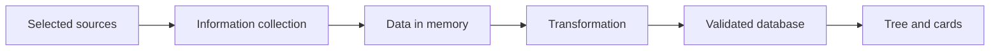

# Stellaris Technological Tree View — concept

## Contents

- [Concept status](#concept-status)
- [Purpose and primary view](#purpose-and-primary-view)
- [Local launch and portability](#local-launch-and-portability)
- [Three data processes](#three-data-processes)
- [Internal data](#internal-data)
- [Sources and localization](#sources-and-localization)
- [First launch](#first-launch)
- [Updating and rebuilding the database](#updating-and-rebuilding-the-database)
- [Open decisions](#open-decisions)

## Concept status

Initially documented on **2026-11-15**. Project name: **Stellaris Technological Tree View**. Directory: `WEB_STTV`.

This is a working concept for a standalone application based on discussion with the user. It describes the purpose, general architecture, and intended workflows. It is **not a technical specification**. The technical foundation, coding principles, and first backend stage are recorded in the [specification](TZ_EN.md); the first database structure is defined in the [database model](DATABASE_MODEL_EN.md). The user approved the first stage, which is now implemented; [operation and validation results](BACKEND_STAGE_1_EN.md) are documented separately.

A standalone database builder, schemas, configuration, checks, and documentation are implemented. The UI and portable distribution remain for subsequent stages. Installed game files are read-only sources; the application does not modify game definitions or create a persistent copy of them.

## Purpose and primary view

The reference application helps users explore Stellaris technologies and their relationships using data from a selected game installation.

The primary view is an interactive dependency tree made of technology cards. Cards use the corresponding vanilla images. The tree is built from the internal database derived from game data and updated after the database is rebuilt.

The exact card content, presentation of details, branch layout, and controls remain to be discussed. A separate catalog view, search, and filters have not been defined yet.

## Local launch and portability

The target platform is Windows. A portable distribution is envisaged as one directory containing an executable, settings, and application data. The user does not need to install a separate web server.

The discussed launch approach is an executable that opens the web interface in a browser and starts the required local service. The first specification part selects Python for processing and the local service, TypeScript and HTML/CSS for the interface, and PyInstaller in `onedir` mode for packaging. The builder dependency and verified environment are listed in the [guide](BACKEND_STAGE_1_EN.md#environment-setup); UI and service libraries are not selected yet.

Settings reside in the application directory; the completed database, reports, and future prepared images reside in configurable `WORK_DIR`, defaulting to `data` within the application. Code is divided into `src/frontend` and `src/backend`. Internal references use relative paths. External source paths are chosen by the user; moving the application may require updating those paths before the next refresh.

A completed database with future prepared images allows browsing without access to the original game directories. During development, the working folder remains inside the repository; `data` also serves product checks. Earlier research materials remain in `TMP/WEB_STTV/` and are not application dependencies.

## Three data processes

The processes have separate inputs and outputs. Reading and transformation pass data in memory without preserving source copies or a persistent intermediate snapshot. This separation allows data to be updated independently of presentation.

| Process | Input | Work | Output |
| --- | --- | --- | --- |
| Initial information collection | Source settings and selected directories | Read permitted files directly and retain provenance | Source data in memory |
| Information transformation | In-memory data and localization source priorities | Parse definitions, perform available computations, validate structure and relationships, and select names | A validated internal database and separate report |
| Presentation | Completed database and prepared images | Build the tree and cards and handle user interaction | The reference application in a web interface |

Presentation reads the completed internal database. Collection is explicitly requested and rereads selected sources. Image preparation and presentation belong to later stages; the first backend version builds a database with RU/EN names.

## Internal data

JSON is selected for the internal database and structured data exchange. The [first database model](DATABASE_MODEL_EN.md) defines one file containing technologies, categories, tiers, local variables, and RU/EN names. Images are intended to be prepared separately in later stages.

The concept distinguishes these materials:

| Material | Purpose |
| --- | --- |
| Source settings | Selected paths and localization priorities |
| Initial information | In-memory data before conversion; not persisted to disk |
| Completed database | Technologies, relationships, prepared text, and provenance |
| Build report | Validation results and diagnostics separate from the database |
| Prepared images | Vanilla images in a form suitable for the web interface |

It remains possible to identify the source of a technology definition and its text. The intended user distribution contains the application with an empty database, which is populated from user-selected sources.

## Sources and localization

The user selects the directories from which the application obtains game data. The developer's particular paths are not mandatory application settings.

Localization uses an ordered list of sources. Priority applies **to each key individually**: the value from the highest-priority source containing that key is selected. If the key is absent, lookup continues in the next source. This allows incomplete translations to be supplemented by subsequent sources. The selected text's provenance is retained.

The current Russian translation order in this repository provides an example:

1. `Localisation_Base/1-Prio_Russian_Localization_Fix_RE/replace/`.
2. Other files under `Localisation_Base/1-Prio_Russian_Localization_Fix_RE/`.
3. Vanilla localization under `Localisation_Base/2-Prio_Vanilla/`.

This example illustrates configurable priorities. It does not make a particular localization mod a mandatory application dependency.

The known installed game path for research in the current environment is `E:\SteamLibrary\steamapps\common\Stellaris\`. It is strictly read-only. Individual technology definitions reside in `common/technology/`; related variables, localization, and images are also read from sources as processing requires.

Support for modded game definitions and their merging rules has not been defined. Localization priorities do not themselves establish override order for game code.

## First launch

The proposed first-launch workflow is:

1. The user launches the application from its directory.
2. An empty database leads to source setup.
3. The user specifies the necessary directories and localization priorities.
4. The application collects initial information.
5. In-memory data is transformed into a validated internal database; image preparation is added at a later stage.
6. Once data preparation finishes, the technology tree opens.

On subsequent launches, the reference uses its existing database. Browsing prepared data does not require selecting directories or collecting information again.

## Updating and rebuilding the database

The user can reopen source settings, change directories and localization priorities, and then refresh the database. Changes to selected paths or their order apply to the new processing run.

Each rebuild rereads selected sources in read-only mode and creates a new database. There is no persistent-snapshot transformation workflow. Rebuilding requires source-directory access; browsing an existing database does not. After a game update, rebuilding uses the updated files.

The new database is validated before replacing the active data. A pre-replacement error must not substitute partial output for the working database. First-stage checks and diagnostics are described in the specification; subsequent image preparation and interface status presentation are discussed separately.

## Open decisions

The following topics remain for further discussion:

- Technology card content and details, tree navigation, search, and filters.
- Interface languages and display of missing names; the first database stores RU/EN and `null` for absent translations.
- Presentation of availability conditions, conditional technology variants, and links to other game objects.
- Handling mods, DLC, and multiple source sets.
- JSON schema and source extensions after the first stage.
- The interface framework, graph library, specific versions of selected technologies, build details, and Windows environment requirements.
- Future interface presentation of source errors, unresolved references, and interrupted processing.

These topics do not automatically add features. Implementation scope will be recorded separately in a technical specification after discussion.

[Концепт на русском](CONCEPT_RU.md) · [Project overview](../README_EN.md).
