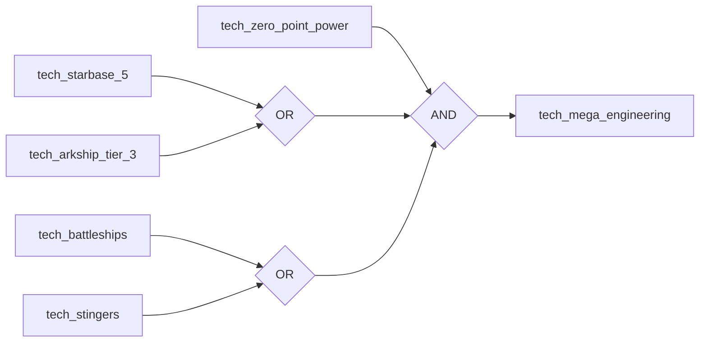

# Stellaris Technological Tree View — technology tree research

## Contents

- [Status and scope](#status-and-scope)
- [Source data inventory](#source-data-inventory)
- [Technology definition structure](#technology-definition-structure)
- [Dependencies and alternative requirements](#dependencies-and-alternative-requirements)
- [Technology tiers](#technology-tiers)
- [Eligibility and research draws](#eligibility-and-research-draws)
- [Conditional technology variants](#conditional-technology-variants)
- [Repeatable technologies](#repeatable-technologies)
- [Cards and parsing considerations](#cards-and-parsing-considerations)
- [Findings for further discussion](#findings-for-further-discussion)
- [Checks and limitations](#checks-and-limitations)
- [Sources and working materials](#sources-and-working-materials)

## Status and scope

Date: **2026-11-15**. The installed **Stellaris Cygnus v4.5.4 (1b4f)** was examined; the version was read from `launcher-settings.json`.

This is source-data research for subsequent design, not a new approved specification part. It covers technology definitions, their dependencies, and mechanisms affecting the meaning of those dependencies. It does not build a complete catalogue of unlocked buildings, components, decisions, or other objects. Mods are excluded from the counts.

The central finding: this version's “technology tree” is a **directed graph with logical requirement groups and conditional node variants**. The complete source graph and the research options available to a particular country are different views.

## Source data inventory

The main source is `E:/SteamLibrary/steamapps/common/Stellaris/`. All game paths below are relative to that directory.

| Source | Contents |
| --- | --- |
| `common/technology/*.txt` | Technology definitions; not every file contains technologies |
| `common/technology/category/00_category.txt` | Research categories |
| `common/technology/tier/00_tier.txt` | Tier unlock thresholds and tier weight modifiers |
| `common/scripted_variables/*.txt` | Shared values, such as `@tier5cost3` |
| `common/defines/00_defines.txt` | General research selection parameters |
| `common/scripted_triggers/`, `common/inline_scripts/` | Conditions and inclusions used by definitions |
| `events/`, `common/scripted_effects/`, and other game definitions | Additional ways of receiving a technology or research option |
| `localisation/`, `gfx/interface/icons/technologies/` | Card text and images |

Results of scanning the top level of `common/technology/`:

| Measure | Result |
| --- | ---: |
| `.txt` files checked / files containing definitions | 33 / 31 |
| Base definitions / unique IDs | 679 / 679 |
| Physics / society / engineering, using base `area` | 168 / 312 / 199 |
| Categories | 13 |
| References in `prerequisites` / unique linked ID pairs | 615 / 615 |
| Technologies with `OR` prerequisite groups | 19 |
| References between different base research areas | 91 |
| Technologies without specified predecessors | 178 |
| Nodes without incoming or outgoing `prerequisites` references | 115 |
| `technology_swap` blocks / technologies containing them | 206 / 180 |
| Variants replacing area and category | 11 |
| Repeatable technologies | 26 |

These are **definition** counts, including special, starting, and conditionally available technologies. They do not mean that every country can research all 679 technologies. An isolated node does not establish that a technology is broken or unavailable.

## Technology definition structure

The ID is the outer block name, such as `tech_mega_engineering`. The filename, localized name, and ID are separate concepts.

| Field | Relevance to tree research |
| --- | --- |
| `area` | Research area: `physics`, `society`, or `engineering` |
| `category` | A list of categories, such as `{ voidcraft }`; its list structure matters |
| `tier` | Technology tier; not distance from a graph root |
| `prerequisites` | An expression of predecessor technology requirements |
| `potential` | Country eligibility conditions |
| `weight`, `weight_modifier` | Base weight and rules modifying research draw weight |
| `start_tech`, `starting_potential` | Starting acquisition and its additional conditions |
| `technology_swap` | Conditional presentation and property variants of the same base technology |
| `levels`, `cost_per_level` | Repeatability and cost increments across repeat levels |
| `cost` | A number, variable reference, or evaluated block |
| `is_rare`, `is_dangerous`, `is_insight` | Additional technology attributes |
| `icon` | An explicit image override |
| `modifier`, `feature_flags`, `prereqfor_desc` | Effects, unlocked features, and result descriptions; not a predecessor list |
| `ai_weight` | AI preference rules; not the player's research draw weight |

Variable resolution example: `tech_mega_engineering` has `cost = @tier5cost3`; `common/scripted_variables/00_scripted_variables.txt:250` sets that variable to `24000`. This is a source cost, not a guaranteed research cost for every country.

## Dependencies and alternative requirements

Ordinary `prerequisites` entries are required together. An `OR` group requires one of its entries. Multiple `OR` groups in the same block remain separate requirements: they cannot be merged into one alternative group or flattened into entirely mandatory references.

An illustrative example is `common/technology/00_megastructures.txt:6`:

```text
prerequisites = {
    OR = {
        tech_starbase_5
        tech_arkship_tier_3
    }
    tech_zero_point_power
    OR = {
        tech_battleships
        tech_stingers
    }
}
```

The condition is `(tech_starbase_5 OR tech_arkship_tier_3) AND tech_zero_point_power AND (tech_battleships OR tech_stingers)`.



The logical nodes explain the source expression; the application's rendering approach has not been selected.

Cross-area dependencies are normal: physics technology `tech_basic_science_lab_3` requires society technology `tech_colonial_centralization` (`00_phys_tech.txt:99`). The three research areas cannot be treated as independent trees without connections between them.

The union graph of all 615 references, including alternatives, is **acyclic** in the examined data. This is a check result for this version, not a guarantee for future sources. Every referenced predecessor ID exists. There are 178 technologies without predecessors, including four explicitly empty `prerequisites` blocks; missing dependencies do not remove other eligibility conditions.

## Technology tiers

This version uses tiers `0–5`:

| `tier` | 0 | 1 | 2 | 3 | 4 | 5 |
| --- | ---: | ---: | ---: | ---: | ---: | ---: |
| Technologies | 38 | 82 | 161 | 142 | 109 | 147 |

`common/technology/tier/00_tier.txt` sets `previously_unlocked = 0` for tier 1 and `6` for tiers 2–5. The accompanying file documentation describes this as the required count of researched technologies from the previous tier. Generated engine documentation describes `can_research_tier` with `tier` and `area` parameters (`triggers.log:2038`). Tier unlock thresholds should therefore be considered separately from individual predecessor lists. Counting behavior in unusual situations has not been tested in the game.

**`tier` is not graph depth.** Of the 615 references, 409 lead to a higher tier, 193 connect the same tier, and 13 lead to a lower tier. For example, `tech_mine_dark_matter` has `tier = 3` but requires tier-4 `tech_sensors_4` (`00_strategic_resources_tech.txt:517`). This is an observation about the source data, not a reason to modify the game.

The `tier`, a numeric suffix in an ID, and a repeatable research level are three different concepts. Even the comment in the `000_documentation.txt` template about predecessors from the previous tier does not describe every actual definition in this version.

## Eligibility and research draws

Dependencies answer “which technologies are required.” They are insufficient to answer “can this technology appear for this country now.”

1. `potential` contains country, DLC, origin, and other restrictions, sometimes through separate scripted triggers.
2. `start_tech` and `starting_potential` describe starting acquisition. There are 42 definitions with `start_tech = yes`; this matches neither the root count nor the tier-0 count.
3. `weight_modifier` can increase, reduce, or zero the weight under specified conditions. A `has_technology` occurrence inside such a modifier is not necessarily a prerequisite. For example, a neighbor having `tech_titans` increases its weight (`00_eng_tech.txt:306`).
4. General selection parameters, group weights (`weight_groups`, `mod_weight_if_group_picked`), and tier modifiers also exist. The base alternative count in defines is 3 (`00_defines.txt:1111`), not a promise of exactly three options regardless of modifiers or events. Weight is not a fixed percentage probability.
5. An event can add a research option, and an effect can grant a technology directly. `events/leviathans_events_2.txt:2937` executes `add_research_option = tech_enigmatic_encoder`, although that technology definition has zero base weight and multiplier. `events/utopia_shroud_events.txt:4003` adds `tech_psi_jump_drive_1` as an option; `common/patrons/patron_types.txt:1200` grants it through `give_technology`.

A revealing case is `tech_fe_assembly_1`: its weight modifier counts several `has_technology` conditions, including its own ID (`00_fallen_empire_tech.txt:832`). Turning every such occurrence into a tree edge would introduce false dependencies and a self-loop.

The name `can_research_technology` should not be interpreted as “currently available to research”: generated documentation (`triggers.log:904`) describes checking `potential` for the technology and its prerequisites, rather than ownership of all researched predecessors.

There are 97 definitions with an unambiguous base `weight = 0`, 38 without the field, and three with conflicting repeated values. None of these cases alone justifies excluding a technology from the reference. Exhaustive acquisition tracing and exact probability reconstruction require separate research.

## Conditional technology variants

`technology_swap` is nested in a base definition and has its own `trigger`. The data contains 206 such blocks across 180 technologies. These are not 206 additional independently researchable technologies.

Variants can change the name, image, effects, weight, research area, and category. `inherit_icon` and `inherit_effects` control inheritance of the respective properties. Eleven variants explicitly replace both area and category.

For example, base `tech_titans` belongs to `engineering` / `voidcraft`. With `country_uses_bio_ships = yes`, variant `tech_biogenesis_titans` specifies `society` / `biology`, `inherit_icon = no`, and `inherit_effects = yes` (`00_eng_tech.txt:289`). Classification by base `area` alone therefore does not describe every card a player may see.

A variant's `name` sometimes matches a base technology ID; the same name can also recur in different conditional blocks. This occurs in `tech_basic_science_lab_3` (`00_phys_tech.txt:104`), ruling out `name` alone as a unique variant identifier.

The `000_documentation.txt` template states that the first matching variant is selected. Block order has been preserved in the research data. Selection priority when multiple conditions match has not been tested in the game; the comment is not presented as independent confirmation of engine behavior.

## Repeatable technologies

Repetition is specified through `levels`, rather than a separate ID for each additional research:

- Twenty-one technologies have `levels = -1`: repetition without a specified finite limit.
- Five technologies have `levels = 5`: a finite sequence of five levels.

The finite limit occurs in `tech_repeatable_reduced_building_time`, `tech_repeatable_reduced_building_cost`, `tech_repeatable_naval_cap`, `tech_repeatable_command_limit`, and `tech_repeatable_improved_starbase_capacity` in the `00_*_repeatable.txt` files.

Repeatables use separate `cost` and `cost_per_level` values. Shared values in `00_scripted_variables.txt:275` are 50000 and 5000, with tier 5. They apply to 24 definitions, not all of them: `tech_repeatable_lcluster_clue` has tier 2 and cost 2000, while `tech_cosmogenesis_thesis` has tier 4, cost 75000, and increment 70000. Repeatability therefore cannot be identified solely by tier, filename, or the `tech_repeatable_` prefix. These are source parameters; the complete final cost calculation with game modifiers is not reproduced here.

Design needs to retain finite limits and avoid expanding unlimited repetition into an infinite chain of nodes. The actual presentation of repeat levels remains to be agreed.

## Cards and parsing considerations

The base name uses the ID localization key, and the description uses `<ID>_desc`. Text should be associated by key, not filename or line order. Variants have their own names. Localization priorities remain as recorded in the concept; a complete text audit is outside this research.

For all 679 base technologies, `gfx/interface/icons/technologies/<icon>.dds` exists, where `<icon>` is the explicit `icon` field or the ID. Twelve definitions override the icon explicitly; for example, `tech_robot_assembly_complex` uses `tech_mega_assembly` (`00_eng_tech.txt:3429`). This checks file existence, not DDS decoding or every variant image.

Relevant source parsing considerations:

- Blocks, atom lists, strings, comments, comparison operators, variables, and repeated fields require structural preservation. A simple “key → single value” dictionary loses information.
- `@...` variables occur both locally and in shared `scripted_variables`. The research check resolves unambiguous scalar references while retaining original entries.
- Cost is not always numeric: ten technologies in `00_cosmic_storm_tech.txt` use a block containing `inline_script`; one example is `tech_storm_manipulation:7`. Weight conditions also use inline inclusions.
- Repeated fields include `technology_swap`, `weight_modifier`, `prereqfor_desc`, and occasionally scalars. `tech_orbital_arc_furnace` and `tech_dyson_swarm` in `00_machine_age_tech.txt:665,725` specify `weight = 0` followed by `@tier2weight3` (70). `tech_dyson_gun` in `00_nomads_dlc_tech.txt:732` specifies 0 followed by `@tier3weight3` (50). Engine precedence has not been established; the working report preserves both entries and flags the ambiguity.
- `prereqfor_desc` describes unlocked features. `gateway` is also not a list of mandatory predecessors. Similar-looking field names do not justify adding them to the `prerequisites` graph.

## Findings for further discussion

The following findings derive from the examined data; they are not yet an agreed database or interface contract:

1. Dependencies need their logical requirement expressions alongside ID references. A flat predecessor list cannot represent several independent alternative groups.
2. Area, category, and tier support classification but do not replace dependencies. Cross-area, same-tier, and decreasing-tier dependencies need to remain distinguishable.
3. Eligibility, weights, and acquisition methods need to remain separate from direct dependencies. A static reference can show source rules; determining availability for a specific country requires game-state context and broader analysis.
4. Base IDs and their ordered conditional variants need to remain associated. Showing every variant or selecting variants by profile is a separate user decision.
5. Starting, isolated, special, and repeatable technologies should not be silently discarded. Visibility of these groups and repeat presentation remain open for discussion.
6. Provenance—file, line, version, and source expression—is useful for explaining dependencies and rebuilding data. Source ambiguities should be visible instead of resolved through arbitrary selection.

## Checks and limitations

The temporary audit ran in `TMP/WEB_STTV/`; it is a research tool, not the application's importer implementation.

Completed checks:

- Fifty-eight definition and support files were parsed with two parsers already present in the repository; structures were compared with order and repeated fields preserved.
- Checked balanced braces and strings, uniqueness of 679 IDs, existence of all 615 references, and absence of cycles in the union graph of alternatives.
- Produced statistics, logical expressions, cross-area and non-increasing-tier reference lists, variants, and repeated-field diagnostics.
- No unresolved variables occurred among the checked direct scalar references, and no conflicting shared variable values were found. This does not validate every computation inside nested conditions.
- Found every base image file. Hashes of 60 core source files matched before and after the audit; game files were used read-only.

Not performed: launching the game, checking research draws against a save, complete scripted-trigger / inline-script evaluation, tracing all acquisition events, selecting variants from country state, or calculating actual probabilities and costs. Generated `triggers.log` / `effects.log` were supplementary local documentation; their version was not independently confirmed. Conflicting repeated fields and variant selection priority remain engine-behavior questions.

## Sources and working materials

Primary sources are identified alongside the relevant analysis above. Additional local engine documentation: `C:/Users/RUSBAR/Documents/Paradox Interactive/Stellaris/logs/script_documentation/triggers.log` and `effects.log` (`add_research_option` at line 1220).

The [CWTools technology schema](https://github.com/cwtools/cwtools-stellaris-config/blob/master/config/common/technologies_consolidated.cwt) was also compared. It describes fields, localization by ID, and nested variants, but is not engine source code. The examined schema allows at most one `OR` block, whereas the actual `tech_mega_engineering` definition contains two. Installed definitions take precedence. Requests to the official Stellaris Wiki pages `Technology` and `Technology_modding` returned HTTP 401; their contents were not used as evidence.

- Temporary script: `TMP/WEB_STTV/research_technology_tree.py`.
- Full parsing snapshot, expressions, and hashes: `TMP/WEB_STTV/technology_tree_audit.json`.
- Results of contents, links, RU/EN example consistency, and hash checks: `TMP/WEB_STTV/research_validation_report.json`.
- [First specification part](TZ_EN.md).
- [Исследование на русском](RESEARCH_TECH_TREE_RU.md).
