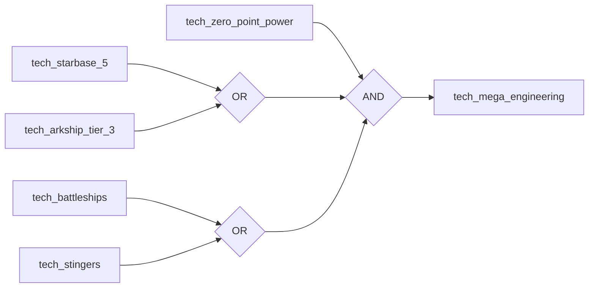

# Stellaris Technological Tree View — исследование технологического древа

## Оглавление

- [Статус и границы исследования](#статус-и-границы-исследования)
- [Состав исходных данных](#состав-исходных-данных)
- [Устройство определения технологии](#устройство-определения-технологии)
- [Связи и альтернативные требования](#связи-и-альтернативные-требования)
- [Уровни технологий](#уровни-технологий)
- [Условия доступа и выпадения](#условия-доступа-и-выпадения)
- [Условные варианты технологий](#условные-варианты-технологий)
- [Повторяемые технологии](#повторяемые-технологии)
- [Карточки и особенности разбора](#карточки-и-особенности-разбора)
- [Выводы для дальнейшего обсуждения](#выводы-для-дальнейшего-обсуждения)
- [Проверки и ограничения](#проверки-и-ограничения)
- [Источники и рабочие материалы](#источники-и-рабочие-материалы)

## Статус и границы исследования

Дата: **2026-11-15**. Исследована установленная **Stellaris Cygnus v4.5.4 (1b4f)**; версия прочитана из `launcher-settings.json`.

Это исследование исходных данных для последующего проектирования, а не новая часть утверждённого ТЗ. Рассматриваются определения технологий, связи между ними и механизмы, меняющие смысл этих связей. Полный каталог открываемых зданий, компонентов, решений и других объектов здесь не строится. Моды не включены в подсчёты.

Главный вывод: «технологическое древо» в этой версии — **ориентированный граф с логическими группами требований и условными вариантами узлов**. Полный граф исходников и доступный конкретному государству набор исследований — разные представления.

## Состав исходных данных

Основной источник — `E:/SteamLibrary/steamapps/common/Stellaris/`. Все приведённые ниже пути игры отсчитываются от этого каталога.

| Источник | Что содержит |
| --- | --- |
| `common/technology/*.txt` | Определения технологий; не каждый файл содержит технологии |
| `common/technology/category/00_category.txt` | Категории исследований |
| `common/technology/tier/00_tier.txt` | Пороги открытия уровней и их модификаторы веса |
| `common/scripted_variables/*.txt` | Общие значения, например `@tier5cost3` |
| `common/defines/00_defines.txt` | Общие параметры выбора исследований |
| `common/scripted_triggers/`, `common/inline_scripts/` | Условия и вставки, используемые определениями |
| `events/`, `common/scripted_effects/` и другие игровые определения | Дополнительные способы получения технологии или варианта исследования |
| `localisation/`, `gfx/interface/icons/technologies/` | Тексты и изображения карточек |

Результаты полного прохода по верхнему уровню `common/technology/`:

| Показатель | Результат |
| --- | ---: |
| Проверено файлов `.txt` / файлов с определениями | 33 / 31 |
| Базовые определения / уникальные ID | 679 / 679 |
| Физика / общество / инженерное дело, по базовому `area` | 168 / 312 / 199 |
| Категории | 13 |
| Ссылки в `prerequisites` / уникальные пары связанных ID | 615 / 615 |
| Технологии с группами `OR` в требованиях | 19 |
| Связи между разными базовыми областями науки | 91 |
| Технологии без указанных предшественников | 178 |
| Узлы без входящих и исходящих связей `prerequisites` | 115 |
| Блоки `technology_swap` / технологии с такими блоками | 206 / 180 |
| Варианты с заменой области и категории | 11 |
| Повторяемые технологии | 26 |

Это статистика **определений**, включая специальные, стартовые и условно доступные технологии. Она не означает, что любое государство может исследовать все 679 технологий. Изолированный узел не является доказательством ошибки или недоступности технологии.

## Устройство определения технологии

ID — имя внешнего блока, например `tech_mega_engineering`. Имя файла, локализованное название и ID — разные сущности.

| Поле | Значение для исследования древа |
| --- | --- |
| `area` | Область науки: `physics`, `society`, `engineering` |
| `category` | Список категорий, например `{ voidcraft }`; структуру списка следует сохранять |
| `tier` | Уровень технологии; не расстояние от корня графа |
| `prerequisites` | Выражение требований к предшествующим технологиям |
| `potential` | Условия допустимости технологии для государства |
| `weight`, `weight_modifier` | Базовый вес и правила изменения веса при выборе исследований |
| `start_tech`, `starting_potential` | Стартовое получение и его дополнительные условия |
| `technology_swap` | Условные варианты представления и свойств той же базовой технологии |
| `levels`, `cost_per_level` | Повторяемость и прибавка стоимости по уровням повторения |
| `cost` | Число, ссылка на переменную либо вычисляемый блок |
| `is_rare`, `is_dangerous`, `is_insight` | Дополнительные признаки технологии |
| `icon` | Явное переопределение изображения |
| `modifier`, `feature_flags`, `prereqfor_desc` | Эффекты, открываемые возможности и описание результатов; не список предшественников |
| `ai_weight` | Правила предпочтений ИИ; не вес выпадения технологии игроку |

Пример разрешения переменной: у `tech_mega_engineering` указано `cost = @tier5cost3`; в `common/scripted_variables/00_scripted_variables.txt:250` эта переменная равна `24000`. Это исходная стоимость, а не гарантированная стоимость исследования для любого государства.

## Связи и альтернативные требования

Обычные элементы `prerequisites` нужны одновременно. Внутри `OR` достаточно одного элемента. Несколько групп `OR` одного блока также являются отдельными требованиями: нельзя объединять их в одну группу альтернатив или превращать все ссылки в обязательные.

Показательный пример — `common/technology/00_megastructures.txt:6`:

```text
prerequisites = {
    OR = {
        tech_starbase_5
        tech_arkship_tier_3
    }
    tech_zero_point_power
    OR = {
        tech_battleships
        tech_stingers
    }
}
```

Условие: `(tech_starbase_5 OR tech_arkship_tier_3) AND tech_zero_point_power AND (tech_battleships OR tech_stingers)`.



Логические узлы на схеме поясняют исходное выражение; способ отрисовки в приложении ещё не выбран.

Межобластные связи обычны: у физической `tech_basic_science_lab_3` среди требований есть общественная `tech_colonial_centralization` (`00_phys_tech.txt:99`). Три области науки нельзя считать независимыми деревьями без связей между ними.

Объединённый граф всех 615 ссылок, включая альтернативные, в изученном наборе **не содержит циклов**. Это результат проверки данной версии, а не гарантия для будущих источников. Все ID предшественников найдены. У 178 технологий нет предшественников, включая четыре явно пустых блока `prerequisites`; отсутствие связи не отменяет прочих условий доступа.

## Уровни технологий

В этой версии используются уровни `0–5`:

| `tier` | 0 | 1 | 2 | 3 | 4 | 5 |
| --- | ---: | ---: | ---: | ---: | ---: | ---: |
| Технологий | 38 | 82 | 161 | 142 | 109 | 147 |

В `common/technology/tier/00_tier.txt` для первого уровня задано `previously_unlocked = 0`, для уровней 2–5 — `6`. Сопроводительное описание файла определяет это как количество исследований предыдущего уровня. Сгенерированная документация движка описывает проверку `can_research_tier` с параметрами `tier` и `area` (`triggers.log:2038`). Таким образом, порог открытия уровня следует рассматривать отдельно от индивидуального списка предшественников. Детали подсчёта в нестандартных случаях в игре не проверялись.

**`tier` нельзя использовать как глубину графа.** Из 615 связей 409 ведут к более высокому уровню, 193 связывают технологии одного уровня, 13 ведут к более низкому. Например, `tech_mine_dark_matter` имеет `tier = 3`, но требует `tech_sensors_4` уровня 4 (`00_strategic_resources_tech.txt:517`). Это наблюдение об исходниках, а не основание исправлять игру.

Уровень `tier`, число в конце ID и уровень повторяемого исследования — три разных понятия. Даже комментарий шаблона `000_documentation.txt` про предшественника предыдущего уровня не описывает все реальные определения текущей версии.

## Условия доступа и выпадения

Связи отвечают на вопрос «какие технологии требуются». Для вопроса «может ли эта технология сейчас появиться у данного государства» данных связей недостаточно.

1. `potential` содержит условия государства, DLC, происхождения и другие ограничения, иногда через отдельные scripted triggers.
2. `start_tech` и `starting_potential` описывают стартовое получение. В наборе 42 технологии имеют `start_tech = yes`; это не совпадает ни с количеством корней, ни с количеством технологий уровня 0.
3. `weight_modifier` может повышать, понижать или обнулять вес при определённых условиях. `has_technology` внутри такого модификатора не обязательно является требованием. Например, у `tech_titans` наличие этой технологии у соседа увеличивает вес (`00_eng_tech.txt:306`).
4. Есть общие параметры выбора, групповые веса (`weight_groups`, `mod_weight_if_group_picked`) и модификаторы уровней. В defines базовое число альтернатив — 3 (`00_defines.txt:1111`); это не обещание ровно трёх вариантов при любых модификаторах и событиях. Вес не равен фиксированной вероятности в процентах.
5. Вариант исследования может добавляться событием, а технология — выдаваться напрямую. В `events/leviathans_events_2.txt:2937` выполняется `add_research_option = tech_enigmatic_encoder`, хотя у определения этой технологии базовый вес и множитель равны нулю. В `events/utopia_shroud_events.txt:4003` добавляется вариант `tech_psi_jump_drive_1`; в `common/patrons/patron_types.txt:1200` эта технология выдаётся через `give_technology`.

Показательный сложный случай — `tech_fe_assembly_1`: в модификаторе веса есть подсчёт нескольких `has_technology`, включая собственный ID (`00_fallen_empire_tech.txt:832`). Если автоматически сделать из всех этих упоминаний рёбра древа, появятся ложные зависимости и петля.

Название `can_research_technology` также нельзя трактовать буквально как «доступно для исследования прямо сейчас»: сгенерированная документация (`triggers.log:904`) описывает проверку `potential` самой технологии и её предшественников, а не проверку наличия всех исследованных предшественников.

Найдено 97 определений с однозначным базовым `weight = 0`, у 38 поле отсутствует, у трёх оно противоречиво повторено. Ни один из этих случаев сам по себе не даёт основания исключать технологию из справочника. Полная реконструкция способов получения и точных вероятностей — отдельный объём исследования.

## Условные варианты технологий

`technology_swap` находится внутри базового определения и имеет собственный `trigger`. Набор содержит 206 таких блоков у 180 технологий. Это не 206 дополнительных независимо исследуемых технологий.

Варианты могут менять название, изображение, эффекты, вес, область и категорию. `inherit_icon` и `inherit_effects` задают наследование соответствующих свойств. У 11 вариантов явно заменяются область и категория.

Например, базовая `tech_titans` относится к `engineering` / `voidcraft`. При `country_uses_bio_ships = yes` вариант `tech_biogenesis_titans` задаёт `society` / `biology`, `inherit_icon = no` и `inherit_effects = yes` (`00_eng_tech.txt:289`). Поэтому классификация только по базовому `area` не описывает все возможные карточки игрока.

`name` варианта иногда совпадает с ID базовой технологии; также одно имя повторяется у разных условных блоков. Это встречается у `tech_basic_science_lab_3` (`00_phys_tech.txt:104`) и исключает использование одного `name` как уникального идентификатора варианта.

Шаблон `000_documentation.txt` сообщает, что выбирается первый подходящий вариант. Порядок блоков в исследовательских данных сохранён. Приоритет при одновременном выполнении нескольких условий в игре не проверялся; значение комментария не выдаётся за независимое подтверждение поведения движка.

## Повторяемые технологии

Повторение задаётся `levels`, а не отдельным ID для каждого нового исследования:

- У 21 технологии `levels = -1`: повторение без заданного конечного предела.
- У пяти технологий `levels = 5`: конечная последовательность из пяти уровней.

Конечный предел найден у `tech_repeatable_reduced_building_time`, `tech_repeatable_reduced_building_cost`, `tech_repeatable_naval_cap`, `tech_repeatable_command_limit`, `tech_repeatable_improved_starbase_capacity` в файлах `00_*_repeatable.txt`.

Для повторяемых технологий используются отдельные `cost` и `cost_per_level`; общие значения в `00_scripted_variables.txt:275` — 50000 и 5000, `tier` — 5. Они применены к 24 определениям, но не ко всем: `tech_repeatable_lcluster_clue` имеет уровень 2 и стоимость 2000, а `tech_cosmogenesis_thesis` — уровень 4, стоимость 75000 и прибавку 70000. Поэтому повторяемость нельзя определять только по уровню, имени файла или префиксу `tech_repeatable_`. Это параметры исходников; полная формула итоговой цены с игровыми модификаторами здесь не воспроизводится.

При проектировании важно не потерять конечный предел и не превращать бесконечное повторение в бесконечную цепочку узлов. Конкретное отображение уровней повторения ещё предстоит согласовать.

## Карточки и особенности разбора

Для базового названия используется ключ ID, для описания — `<ID>_desc`. Текст следует связывать по ключу, а не по имени файла или порядку строк. У вариантов имеются собственные имена. Приоритеты локализации остаются теми, что зафиксированы в концепте; полноценная проверка текстов в это исследование не входит.

Для всех 679 базовых технологий найден файл `gfx/interface/icons/technologies/<icon>.dds`, где `<icon>` — явное поле `icon` либо ID. В 12 определениях есть явное переопределение; например, `tech_robot_assembly_complex` использует `tech_mega_assembly` (`00_eng_tech.txt:3429`). Проверено существование файлов, а не декодирование DDS или все изображения вариантов.

При разборе исходников важны следующие особенности:

- Блоки, списки атомов, строки, комментарии, операторы сравнений, переменные и повторяющиеся поля требуют сохранения структуры. Обычное преобразование в словарь «ключ → одно значение» потеряет данные.
- Переменные `@...` встречаются как в самом файле, так и в общих `scripted_variables`. Исследовательская проверка разрешает однозначные скалярные ссылки, сохраняя исходные записи.
- Стоимость не всегда число: у десяти технологий из `00_cosmic_storm_tech.txt` это блок с `inline_script`; пример — `tech_storm_manipulation:7`. Inline-вставки встречаются также в условиях веса.
- Повторяются не только `technology_swap`, но и `weight_modifier`, `prereqfor_desc`, иногда скалярные поля. У `tech_orbital_arc_furnace` и `tech_dyson_swarm` в `00_machine_age_tech.txt:665,725` сначала задан `weight = 0`, затем `@tier2weight3` (70). У `tech_dyson_gun` в `00_nomads_dlc_tech.txt:732` — 0, затем `@tier3weight3` (50). Правило приоритета движка не установлено; в рабочем отчёте сохранены обе записи и отмечена неоднозначность.
- `prereqfor_desc` — описание открываемых возможностей. `gateway` также не является списком обязательных предшественников. Такие поля нельзя подмешивать в граф `prerequisites` по похожему названию.

## Выводы для дальнейшего обсуждения

Следующие выводы вытекают из изученных данных; это ещё не согласованный контракт базы или интерфейса:

1. Для связей необходимо сохранять логическое выражение требований наряду со ссылками на ID. Плоский список предшественников не передаёт несколько независимых групп альтернатив.
2. Область, категория и уровень полезны для классификации, но не заменяют связи. Межобластные, одноуровневые и обратные по `tier` связи должны оставаться различимыми.
3. Условия допуска, веса и способы получения необходимо отделять от прямых связей. Статический справочник может показывать исходные правила; определение доступности для конкретного государства требует контекста партии и более широкого анализа.
4. Базовый ID и упорядоченные условные варианты должны оставаться связанными. Представление всех вариантов или выбор варианта по профилю — отдельное решение пользователя.
5. Стартовые, изолированные, специальные и повторяемые технологии нельзя молча отбрасывать. Видимость этих групп и способ показа повторений ещё обсуждаются.
6. Происхождение данных — файл, строка, версия, исходное выражение — полезно сохранять для объяснения связи и повторной сборки. Неоднозначности исходников следует делать видимыми, а не разрешать произвольным выбором.

## Проверки и ограничения

Временный аудит выполнен в `TMP/WEB_STTV/`; это исследовательский инструмент, не реализация импортера приложения.

Проверено:

- 58 файлов определений и вспомогательных данных разобраны двумя существующими в репозитории парсерами; структуры сопоставлены с сохранением порядка и повторов.
- Проверены баланс скобок и строк, уникальность 679 ID, существование всех 615 ссылок и отсутствие циклов в объединённом графе альтернатив.
- Получены статистика, логические выражения, список межобластных и не возрастающих по уровню связей, варианты и диагностика повторных полей.
- В проверенных прямых скалярных ссылках нет неразрешённых переменных; конфликтующих значений общих переменных не найдено. Это не проверка всех вычислений внутри вложенных условий.
- Найдены все базовые файлы изображений. Хеши 60 основных исходных файлов совпали до и после аудита; файлы игры использовались только для чтения.

Не выполнялись запуск игры, проверка выбора исследований на сохранении, полное вычисление scripted triggers / inline scripts, реконструкция всех событий получения, выбор вариантов по состоянию государства, расчёт фактических вероятностей и стоимости. Сгенерированные `triggers.log` / `effects.log` использованы как дополнительная локальная документация; их версия отдельно не подтверждена. Неоднозначные повторные поля и порядок выбора вариантов остаются вопросами поведения движка.

## Источники и рабочие материалы

Основные первичные источники перечислены по месту разбора выше. Дополнительная локальная документация движка: `C:/Users/RUSBAR/Documents/Paradox Interactive/Stellaris/logs/script_documentation/triggers.log` и `effects.log` (`add_research_option` — строка 1220).

Сопоставлена также [схема технологий CWTools](https://github.com/cwtools/cwtools-stellaris-config/blob/master/config/common/technologies_consolidated.cwt). Она описывает поля, локализацию по ID и вложенные варианты, но не является исходным кодом движка. В просмотренной версии схемы для `OR` указана кратность до одного блока, тогда как реальная `tech_mega_engineering` содержит два. Приоритет отдан установленным определениям. Официальные страницы Stellaris Wiki `Technology` и `Technology_modding` при обращении вернули HTTP 401; их содержимое не использовано как подтверждение.

- Временный скрипт: `TMP/WEB_STTV/research_technology_tree.py`.
- Полный снимок разбора, выражения и хеши: `TMP/WEB_STTV/technology_tree_audit.json`.
- Результат проверки оглавлений, ссылок, согласованности примеров RU/EN и хешей: `TMP/WEB_STTV/research_validation_report.json`.
- [Первая часть ТЗ](TZ_RU.md).
- [English research report](RESEARCH_TECH_TREE_EN.md).
